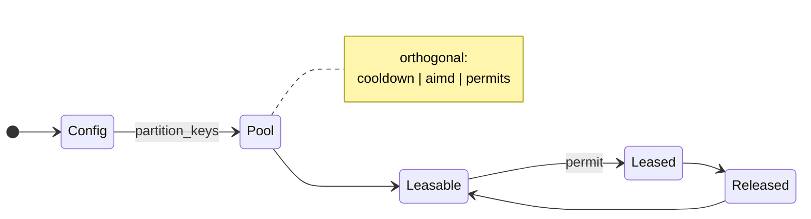
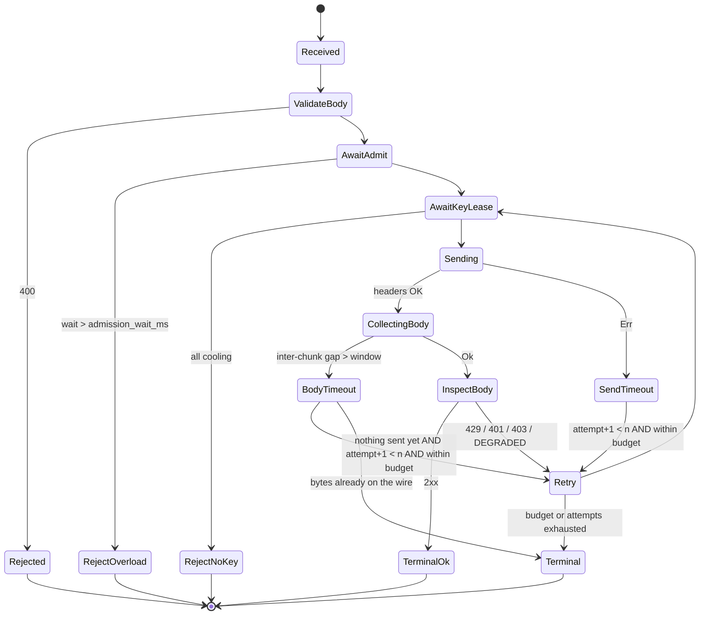

# nimaproxy — Formal Engineering Design

This document specifies nimaproxy's behaviour as state machines, so that
changes are made against a spec instead of against control flow. It is
written from the source at `3cde1eb`..`3268c24`, not from memory.

## 0. Why this document exists

Three defects in this session were all the same shape: a state was never
modelled, so the code's behaviour was whatever its statements happened to
do.

1. `disabled = true` was silently dropped because `KeyEntry` had no such
   field ([`fix`](../../commit/3cde1eb)). A state existed in the config, in
   the operator's head, and nowhere in the type system.
2. `upstream_attempts` counted admissions that failed, reaching 114x the
   true upstream call count. The counter was incremented on permit
   acquisition, before the key lease that gives it meaning.
   ([`fix`](../../commit/e1e49db))
3. The retry budget excluded admission wait, so instrumentation showed
   `elapsed=16546ms budget=30500ms fits=false` and the retry never fired.
   The budget modelled attempt time; the code measured request time.
   ([`fix`](../../commit/3268c24))

Each was invisible to review and to the test suite, and each was found by
measuring the running binary. The fix is not three more tests. The fix is
making the states explicit so the compiler and the reviewer can see them.

## 1. Vocabulary

Terms used with their formal meanings.

- **State** — a set of values that determines which transitions are
  available. Distinguished here from a *counter* (a number) and a
  *projection* (a value computed from other state at read time).
- **Transition** — a function `(state, event) -> state`, with optional
  guards and side effects.
- **Guard** — a boolean predicate evaluated before a transition fires.
- **Invariant** — a predicate true in every reachable state.
- **Safety** — "something bad never happens."
- **Liveness** — "something good eventually happens."
- **Orthogonal region** — a sub-machine that evolves independently of its
  siblings, per Harel statecharts (Harel 1987; SCXML §B.2).
- **Run-to-completion** — a transition completes before the next event is
  processed, so no event is observed against a half-updated state.

## 2. The five state machines

nimaproxy contains five distinct state machines. They are currently
implicit: spread over 8,135 lines, only one of them has a name in the
type system.



### 2.1 Machine A — Config (compile-time, mostly)

| State | Representation | Notes |
|---|---|---|
| `KeyEntry` | struct, `src/config.rs:114` | `disabled: bool` is an implicit flag, not a variant |
| Parked | `disabled == true` | excluded in `partition_keys`, `src/config.rs:74` |
| Leasable | `disabled == false` | only these reach the pool |

`Config::partition_keys` (`src/config.rs:74`) is the transition. Its
invariant: **a parked key must never appear in `KeyPool`**. Verified by
`main.rs:96`, which retains only leasable keys.

### 2.2 Machine B — Key lifecycle (the one that is not a state machine)

A single key's lifecycle is currently three independent projections over
three separate mutexes, plus a semaphore. There is no `enum KeyState`.

| Derived state | How it is determined | file:line |
|---|---|---|
| Leasable | `cooldowns[idx]` is `None`, or `Some(expiry)` already past | `key_pool.rs:99`, `:121` |
| Cooling (429) | `Some(expiry)`, `now < expiry` | `key_pool.rs:100`, `:121` |
| Quarantined (401/403) | **the same storage as cooling** — `Some(expiry)` | `key_pool.rs:176-187` |
| AIMD-throttled | `KeyWindow.current < max_in_flight_per_key` | `key_pool.rs:23`, `:239` |
| In flight | counter: `max − permits[i].available_permits()` | `key_pool.rs:246` |

Transitions are free functions mutating separate mutexes:

```
mark_rate_limited(idx, secs)   -> record_rate_limited(idx) ; cooldowns[idx] = Some(now+secs)
mark_auth_failed(idx, secs)    -> auth_failures[idx] += 1  ; cooldowns[idx] = Some(now+secs)
record_success(idx)            -> window.current += 1 (if allowed)
record_rate_limited(idx)       -> window.current = (current/2).max(1)
```

**Defect (design, not code): cooling and quarantined are the same state.**
A revoked key and a rate-limited key occupy identical storage and take an
identical skip path; the only difference is that `auth_failures[idx]`
increments. The 15-minute quarantine and the 60-second cooldown are the
same state with a different duration, so nothing downstream can ask "which
kind of failure was this?" That question is exactly what an operator
needs, and today it can only be answered by grepping `turns.jsonl`.

**Defect (real, not stylistic): state reads are not atomic.**
`available_permits` (`key_pool.rs:261`) locks `cooldowns[i]`, then reads
`permits[i]` and `windows[i]` in two further uncoordinated reads. A
concurrent `mark_rate_limited` between them yields a snapshot that never
existed. The report is a *plausible* wrong value rather than a
fail-loud error — the worst failure mode for an observability surface.

### 2.3 Machine C — Request lifecycle

The request FSM is implemented twice. `chat_completions`
(`src/proxy.rs:845`) implements the full sequence with a retry decision on
both timeout paths; `solo_model_fallback` (`src/proxy.rs:504`) implements
a near-copy whose timeout branches simply `break` to the next key/model
with no budget guard at all. `race_models` (`src/proxy.rs:~1935`)
implements fanout over separate tasks. The retry-budget logic lives in two
places (`src/proxy.rs:956`, `:1155`) and the body-timeout retry shipped in
only one of them until `38a056d`, which is precisely why the session
produced a retry that never fired in production.

States, as implied by the code:



The `Retry` transition carries the guards above, and all of them must
hold:

```
nothing has reached the client            AND
attempt + 1 < n                           AND
started.elapsed() + window <= attempt_budget
```

where `attempt_budget = window*2 + admission_wait_ms + slack_ms`
(`src/proxy.rs:902`). The second guard encodes a **liveness** property:
"a retry will be attempted whenever one more window fits" — and its first
formulation violated exactly that, silently, because `elapsed` includes
the admission wait.

The first guard is the one this session had wrong in both directions.
"Nothing has reached the client" is a property of the response mode, not
of the elapsed time: a streaming response has bytes on the wire the
moment its first chunk is forwarded, while a non-streaming response is
assembled in memory and the caller sees nothing until it completes. That
distinction is now modelled explicitly as `ResponseMode` on the
`on_first_byte` transition (`src/proxy/request_state.rs`), which lands
the request in `Committed` (streaming, never retryable) or `Assembling`
(buffered, still retryable). Before it was modelled, `Committed` was
reached for both, so a stalled non-streaming body was terminal — S3
refusing a retry that could not have double-sent anything.

### 2.4 Machine D — Racing (orthogonal regions)

`race_models` spawns racers into a `JoinSet` (`src/proxy.rs:2120`). Each
racer is an orthogonal region: its own key lease, its own permit, its own
timeout. The join loop is the join node. `tasks.abort_all()`
(`src/proxy.rs:2588`) is a *cancellation* transition, and cancellation is
where the observability defect lives: a permit is acquired and counted at
spawn, then discarded at abort, with the counter never undone.

### 2.5 Machine E — Observability (an event log, already correct in shape)

`turns.jsonl` is an append-only structured log of every interesting
transition. Its fields are enumerated in `src/turn_log.rs:23-83`. This is
already event-sourcing-shaped: the log is the system of record for *what
happened*, and `/stats` is a projection of in-memory counters.

The design gap: **`request_id` is always `None`** (`turn_log.rs:86-121`,
hard-coded). A multi-attempt request writes several records that cannot be
joined, so the log cannot answer "what did this request do?" — only "what
did each attempt do?" That single field is the difference between an event
log and a set of unrelated lines. It also blocks model-checking the log
after the fact: without correlation, there is no single run to replay.

## 3. Invariants worth stating

These are the properties the design should guarantee. Each is checkable
by a test that can fail.

**Safety**

| # | Invariant | Status |
|---|---|---|
| S1 | A parked key is never leased | holds; `partition_keys`, tested |
| S2 | `upstream_attempts` ≤ actual permit acquisitions | holds after `e1e49db`; the old code violated it by 114x |
| S3 | A client receives at most one response body for one request | holds; retries precede the stream conversion |
| S4 | A retried request does not exceed the retry budget | holds; guard in §2.3 |
| S5 | No key is both cooling and leasable | holds; single `cooldowns[idx]` slot |
| S6 | Cooldown and AIMD window changes are atomic together | **violated** — `available_permits` reads across three locks (§2.2) |

**Liveness**

| # | Property | Status |
|---|---|---|
| L1 | Every admitted request eventually returns | holds; every branch terminates |
| L2 | A throttled key returns to full window given enough successes | holds after `8bb07f6` |
| L3 | When another window fits in the budget, a timed-out attempt retries | **violated before `3268c24`**; guard silently false |
| L4 | Turn logging records every terminal transition | partially; overload/no-key rejection produce no turn record |

L3 and S6 are the two open items. L3 was measured failing in production
with three instrumented samples; S6 is a torn-read window rather than an
observed fault, and should be fixed before it becomes one.

## 4. The refinement path

Ordered by risk-adjusted value. Each step keeps the tests green.

### Step 1 — Make the key state machine a type (closes S6)

Replace the three projections with one `KeyState` and one mutex:

```rust
enum KeyState {
    Leasable,
    Cooling { until: Instant, kind: CooldownKind },
    // Quarantined is no longer the same state as Cooling.
}
enum CooldownKind { RateLimited, AuthFailed }

struct KeyEntry { state: Mutex<KeyState>, window: Mutex<KeyWindow>, permits: Arc<Semaphore> }
```

`cooldowns`, `windows`, and `permits` collapse into one `Mutex` guarding
`state` + `window`. Cooldown becomes a variant, not an `Option<Instant>`
that readers must interpret; the 429/401 distinction becomes a field the
`/stats` handler can report directly. This is the single change that makes
the key machine reviewable, and it is what makes S6 provable rather than
asserted.

### Step 2 — Correlate the event log (closes L4, enables verification)

Populate `request_id` with a per-request UUID and thread it through every
`log_turn_request` call. Then:

- every attempt of one request is joinable
- the log becomes replayable, i.e. a trace you can check the FSM against
- operators can ask "what happened to my request" with `grep + jq`

Emit a turn record for terminal *rejection* too (overload, no-key), so
every end state appears in the log exactly once.

### Step 3 — One retry transition, not three

Extract the retry policy into one function returning the transition:

```rust
enum RetryDecision { Retry { bench_key: bool }, GiveUp { reason: GiveUpReason } }

fn decide_retry(attempt: u32, n: usize, started: Instant, window: Duration, budget: Duration)
    -> RetryDecision
```

`chat_completions`, `solo_model_fallback`, and `race_models` all call it.
Today the policy is three copies, and this session shipped a fix that
covered two of three — which is the exact failure this step prevents.

### Step 4 — Property-based testing of the FSM

With `request_id` in the log, adopt the `proper_statem` model (PropEr
`PropCheck.StateM`, QuickCheck `Test.QuickCheck.State`): define an abstract
state machine, generate random command sequences, assert the postcondition
after each. This tests transitions the hand-written cases miss — which is
how §2.3's guard slipped through.

### Step 5 — Bounded model checking

`kani` (bit-precise model checker for Rust) can exhaustively check
bounded state spaces. Targets, in order:

1. `decide_retry` — the transition function is pure, small, and contained;
   a Kani proof here covers L3 exactly.
2. The new `KeyState` transition table — safety S1/S5.
3. `available_permits`-style aggregate reads — the S6 atomicity fix.

Kani proofs are cheap on pure functions and do not need an async runtime.

## 5. What this buys, concretely

Not "better code" — three specific defects that would have been caught:

| Defect | Caught by |
|---|---|
| `disabled` dropped | Step 1: `KeyState` has no "disabled" variant to drop into |
| `upstream_attempts` lying | Step 3: one transition, one place to increment |
| Retry never fired | Steps 4+5: a generated attempt sequence would have hit `fits=false` |

All three survived a suite of 400+ tests, mutation-proven tests, and a
code review, because all three were states that nothing modelled.

## 6. What not to do

- **Do not adopt a state-machine framework crate.** A `statig`-style
  crate would add a dependency and a DSL while leaving the same three
  duplicate retry loops. The value is the explicit type, not the runtime.
- **Do not model `in_flight` as a state.** It is a counter with a
  monotone RAII path (acquire/release); making it a state would add
  transitions with no information.
- **Do not rewrite racing.** It works, and racing is orthogonal to every
  defect in this document.

## References

- D. Harel, *Statecharts: A Visual Formalism for Complex Systems*,
  Science of Computer Programming 8(3), 1987.
- W3C, *State Chart XML (SCXML)*, §B.2 orthogonal regions,
  <https://www.w3.org/TR/scxml>.
- Erlang OTP `gen_statem` design principles,
  <https://www.erlang.org/doc/apps/stdlib/gen_statem.html>.
- PropEr `proper_statem` / QuickCheck `Test.QuickCheck.State`,
  model-based testing of stateful systems.
- Kani, a model checker for Rust, <https://model-checking.github.io/kani>.
- Netflix Hystrix circuit-breaker documentation, for the counter/rolling-
  window model that `GatewayMetrics` partly implements.

---

## 7. Restructure — measured, then done

The split above was guided by two instruments rather than by taste:
`cargo crap` for change risk and `cargo tarpaulin` for coverage. CRAP is
`complexity x (1 - coverage)^3`, so the two tools are directly coupled:
a complex, untested function scores worst.

A note on the instruments, because the first reading was wrong: `cargo crap`
without `--lcov` scores **every** function as 0% covered. That run reported
39 offenders; the real, coverage-aware figure was **13**. The tool's own
help says so, and reading it first would have avoided chasing 26 phantom
targets.

### Before / after (commit `3268c24` -> `8bb07f6`+restructure)

| Metric | Before | After |
|---|---|---|
| CRAP offenders (coverage-aware) | 13 / 251 functions | 12 / 260 |
| Coverage (tarpaulin) | 54.13% (1514/2797) | 54.53% (1522/2791) |
| Largest source file | `src/proxy.rs`, 4312 lines | `src/proxy/racing.rs`, 683 lines |
| Tests (lib / integration / error-path) | 314 / 45 / 44 | 319 / 45 / 44 |

### Module layout

```
src/proxy/           request lifecycle, split by concern
  admission.rs       the gate every attempt passes
  chat.rs            /v1/chat/completions, per-attempt handling
  racing.rs          fan-out racing: candidates, deadlines, join/cancel
  fallback.rs        sequential single-model fallback
  messages.rs        request body transforms, model resolution
  upstream_errors.rs failure classification
  timeouts.rs        per-model timeout policy, turn summaries
  http.rs            remaining handlers, turn recording
src/config/          KeyEntry | racing | load+accessors | tests
src/key_pool/        mod | state | aimd | report | tests
```

Each module now states its concern in a module doc comment, and the
request/key machines have file-level homes. The FSM is still implicit
(§2), which is the next step, not this one.

### A defect the restructure exposed

Moving `TurnLogger` into its own tests required covering
`TurnLogger::log`, which was at **0% coverage** — a CRAP offender at 72.
Writing that test found a **self-deadlock in production code**:

```rust
// src/turn_log.rs, before
let mut writer_guard = self.writer.lock().unwrap();
if writer_guard.is_none() {
    self.open_file()?;          // <-- open_file() locks self.writer AGAIN
    writer_guard = self.writer.lock().unwrap();  // unreachable
}
```

`std::sync::Mutex` is not reentrant, so the second lock blocked forever on
the first one's guard. The trigger is `rotate()` setting the writer to
`None`, so the next `log()` call wedged the calling thread instead of
writing. No crash, no error, no record — turn logging stops, which is the
exact failure shape this whole exercise exists to prevent.

Fixed by checking `is_none()` under a short-lived lock, releasing it, then
calling `open_file()`, then re-locking once to write.

Honest scope note: `rotate()` has **no callers** in the crate, so this was a
**latent** deadlock reachable only once rotation is wired up, not one that
could have affected the running deployment. It is still worth fixing and
covering, because the moment someone adds rotation the write path wedges
silently.

This is the argument for coverage as a design input: a 0% line was not a
gap in the tests but a deadlock in the write path of the operator's only
observability surface.
